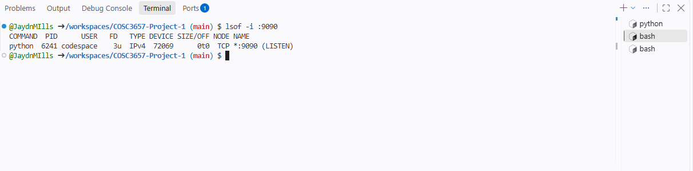
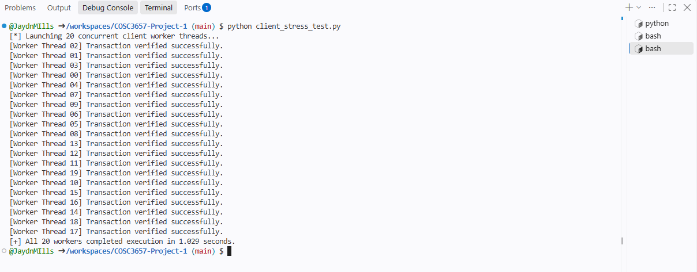
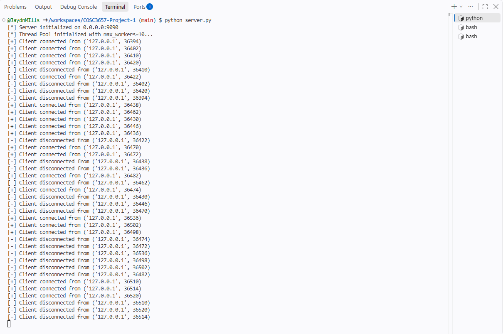

# COSC 3657 Unit 1: Bare-Metal IPC & Custom Protocol Design

**Student:** Jaydn Mills

## Deliverables Checklist
- [x] Complete implementation of `protocol.py` handling partial socket reads (`recv_exact`).
- [x] Complete implementation of `storage.py` wrapped in explicit `threading.Lock` and `threading.Condition` primitives.
- [x] Complete implementation of `server.py` utilizing `concurrent.futures.ThreadPoolExecutor`.
- [x] Terminal screenshot proving all 20 worker threads in `client_stress_test.py` execute without race condition failures or unhandled socket exceptions.

## Verification Screenshot

